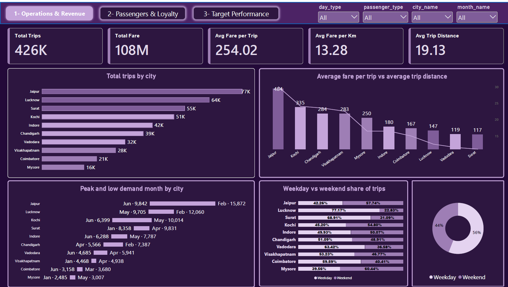
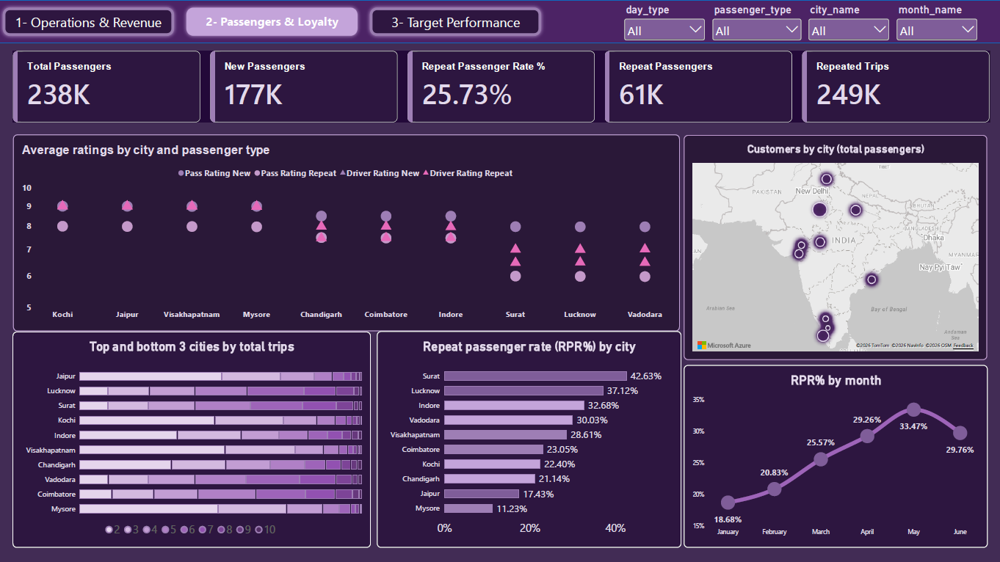
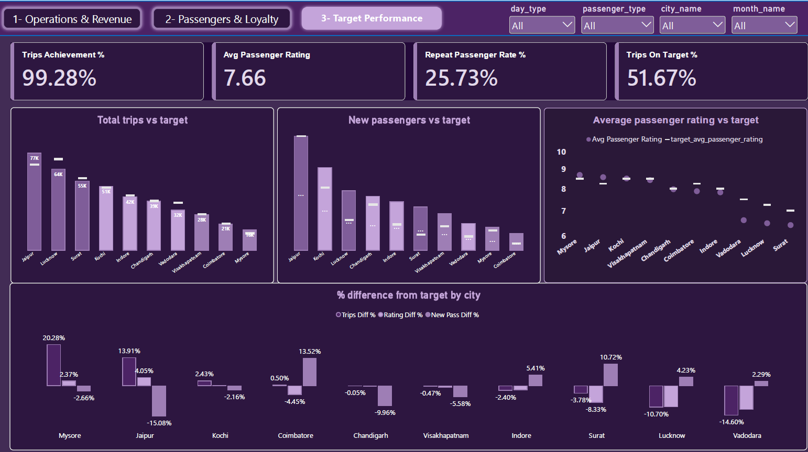

# 🚖 Goodcabs Analytics: Operations, Passenger Loyalty & Target Performance

> End-to-end analytics project for **Goodcabs**, a ride-hailing company operating in 10 Indian tier-2 cities. Built with **SQL Server (T-SQL)** and a **3-page Power BI dashboard**, based on the [Codebasics Resume Project Challenge](https://codebasics.io/challenges/codebasics-resume-project-challenge/16).


---

## 📌 Table of Contents

1. [Business Context](#-business-context)
2. [Business Questions](#-business-questions)
3. [Tech Stack](#-tech-stack)
4. [Data Model](#-data-model)
5. [Methodology & Assumptions](#-methodology--assumptions)
6. [Dashboard Overview](#-dashboard-overview)
7. [Interactive Prototype](#-interactive-prototype)
8. [Key Insights](#-key-insights)
9. [Recommendations](#-recommendations)
10. [Repository Structure](#-repository-structure)
11. [How to Reproduce](#-how-to-reproduce)
12. [Author](#-author)

---

## 🏢 Business Context

Goodcabs is a ride-hailing startup focused on **tier-2 cities in India**, with a mission to provide reliable, affordable and driver-friendly transportation. After its first six months of operation (**January–June 2024**), management needed a data-backed view of:

- How each city performs against its **monthly targets** (trips, new passengers, passenger ratings).
- How well the company **retains passengers** (repeat passenger behaviour).
- Where demand **peaks and dips**, and how **weekday vs. weekend** patterns differ.

---

## ❓ Business Questions

The dashboard answers the 8 primary questions of the challenge:

| # | Question | Dashboard Page |
|---|----------|----------------|
| Q1 | Top and bottom 3 cities by total trips | 1 – Operations & Revenue |
| Q2 | Average fare per trip vs. average trip distance by city | 1 – Operations & Revenue |
| Q3 | Average ratings by city and passenger type (new / repeat) | 2 – Passengers & Loyalty |
| Q4 | Peak and low demand month for each city | 1 – Operations & Revenue |
| Q5 | Weekday vs. weekend share of trips by city | 1 – Operations & Revenue |
| Q6 | Repeat passenger trip frequency distribution | 2 – Passengers & Loyalty |
| Q7 | Performance vs. targets (trips, new passengers, ratings) | 3 – Target Performance |
| Q8 | Repeat Passenger Rate (RPR%) by city and month | 2 – Passengers & Loyalty |

---

## 🛠 Tech Stack

| Layer | Tool | Purpose |
|-------|------|---------|
| Data preparation | **SQL Server (T-SQL)** | Targets database, data loading and preparation |
| Modeling | **Power BI** (Import mode) | Star-schema relationships |
| Calculations | **DAX** | KPIs, ratios, target comparisons |
| Visualization | **Power BI Desktop** | Interactive 3-page report |
| Prototype | **HTML + Chart.js** | Interactive mockup used to design the dashboard |

---

## 🗂 Data Model

The Power BI model (`trips_db`, Import mode) follows a **star schema**:

**Fact tables**
- `fact_trips`: trip-level data (fare, distance, passenger type, ratings)
- `fact_passenger_summary`: monthly passenger counts per city (total, new, repeat)
- `dim_repeat_trip_distribution`: repeat-passenger counts by number of trips taken

**Dimensions**
- `dim_city`: city details, plus calculated columns **City Type**, **City Lat**, **City Lon** (used for the map)
- `dim_date`: calendar with `day_type` (Weekday / Weekend)
- `dim_month`: month hierarchy

**Target tables** (stored in `targets_db`, 130 rows total)

| Table | Columns | Rows |
|-------|---------|------|
| `city_target_passenger_rating` | `city_id` (PK), `target_avg_passenger_rating` | 10 |
| `monthly_target_new_passengers` | `month`, `city_id`, `target_new_passengers` (composite PK) | 60 |
| `monthly_target_trips` | `month`, `city_id`, `total_target_trips` (composite PK) | 60 |

Covered cities (IDs): `AP01, CH01, GJ01, GJ02, KA01, KL01, MP01, RJ01, TN01, UP01`, January–June 2024.

---

## ⚙️ Methodology & Assumptions

1. **Targets database**: the original MySQL 8.0.33 dump (`targets_db.sql`) was converted to **T-SQL** (`targets_db_sqlserver.sql`): `IF DB_ID(...) IS NULL CREATE DATABASE`, `GO` batch separators, `dbo` schema, named primary-key constraints, bracketed `[month]`, and removal of MySQL-specific syntax (backticks, `ENGINE`, `LOCK TABLES`, etc.).
2. **Modeling**: tables imported into Power BI, related through `city_id` and the date/month dimensions.
3. **DAX measures** (full list in [`powerbi/dax/measures.dax`](powerbi/dax/measures.dax)):
   - *Core:* Total Trips, Total Fare, Avg Fare per Trip, Avg Fare per Km, Avg Trip Distance
   - *Passengers:* Total Passengers, New Passengers, Repeat Passengers, Repeat Passenger Rate %
   - *Targets:* Trips Target, Trips Achievement %, Trips Diff %, Trips On Target %
   - *Demand (Q4):* Peak Trips, Low Trips, Trip Range
4. **Design**: 3 pages (1280×720), max 5 KPI cards per page, no tables, consistent purple palette, and global slicers for City type, City, Month, Day type and Passenger type.

**Assumptions made**
- **City type** (Tourism vs. Business) is *not* in the source data. It was assigned as an assumption: **Jaipur, Kochi, Mysore, Visakhapatnam = Tourism**; all others = Business.
- **Target status:** *Exceeded* if above **+1%** of target, *Met* within **±1%**, *Missed* below **−1%**.
- **Customer count** on the map = sum of monthly total passengers per city.

---

## 📊 Dashboard Overview

### 1️⃣ Operations & Revenue


**KPIs:** Total Trips **426K** · Total Fare **108M** · Avg Fare per Trip **254.02** · Avg Fare per Km **13.28** · Avg Trip Distance **19.13 km**

### 2️⃣ Passengers & Loyalty


**KPIs:** Total Passengers **238K** · New Passengers **177K** · Repeat Passenger Rate **25.73%** · Repeat Passengers **61K** · Repeated Trips **249K**

### 3️⃣ Target Performance


**KPIs:** Trips Achievement **99.28%** · Avg Passenger Rating **7.66** · Repeat Passenger Rate **25.73%** · Trips On Target **51.67%**

---

## 🧪 Interactive Prototype

Before building in Power BI, the layout was designed as an interactive HTML mockup: [`prototype/goodcabs_dashboard_v2.html`](prototype/goodcabs_dashboard_v2.html).

> ⚠️ The prototype uses **generated sample data** for layout and interaction design. Its numbers are **not** the real results; refer to the Power BI dashboard for actual figures.

---

## 🔍 Key Insights

### Operations & Revenue
- **Demand is concentrated.** Jaipur leads with ~**77K trips**, then Lucknow (~64K) and Surat (~55K); Mysore is lowest (~16K).
- **Volume and fare per trip don't move together.** Jaipur has the highest average fare per trip (~484), while Surat, third in volume, has the lowest (~117).
- **Peak months differ by city.** Jaipur and Lucknow peak in **February**; Kochi, Indore and Mysore in **May**; Surat, Vadodara and Visakhapatnam in **April**. June is the low point for several cities.

### Passengers & Loyalty
- **Retention is the main growth lever.** Only **25.73%** of passengers are repeat riders, yet **61K repeat passengers generated 249K trips**.
- **Large gap between cities.** Surat (**42.63%**), Lucknow (37.12%) and Indore (32.68%) retain best; Mysore (**11.23%**) and Jaipur (17.43%) lag. **Jaipur is the biggest city by trips but among the weakest in retention.**
- **Positive trend.** RPR% rose from **18.68% (Jan)** to **33.47% (May)**, then dipped to 29.76% in June.

### Target Performance
- Overall volume is on target (**99.28%**), but only **51.67%** of results hit their trip targets, so the headline hides city-level misses.
- Cities beating their trip target often miss their rating or new-passenger target (and vice versa).

---

## 💡 Recommendations

1. **Launch loyalty programmes in low-RPR, high-volume cities** (Jaipur, Mysore): ride bundles, repeat-ride discounts, referral credits.
2. **Replicate Surat's and Lucknow's retention playbook** in underperforming cities by identifying what differs operationally.
3. **Plan capacity and promotions per city**, using each city's own peak and trough months.
4. **Review pricing and trip-length strategy in Surat**, where high volume pairs with the lowest fare per trip.
5. **Investigate cities missing rating targets** and link rating drops to repeat-passenger churn.
6. **Set seasonality-aware, city-specific targets** to make "Trips On Target %" a fairer measure.

---

## 📁 Repository Structure

```
goodcabs-analytics/
├── README.md
├── .gitignore
├── sql/
│   └── targets_db_sqlserver.sql
├── powerbi/
│   ├── Goodcabs.pbix
│   └── dax/
│       └── measures.dax
├── prototype/
│   └── goodcabs_dashboard_v2.html
└── docs/
    ├── primary_and_secondary_questions.pdf
    └── images/   (dashboard screenshots)
```

> The `images/` paths used above in this README should point to `docs/images/` if you keep that structure.

---

## 🚀 How to Reproduce

1. **Clone** the repository:
   ```bash
   git clone https://github.com/<your-username>/goodcabs-analytics.git
   ```
2. In **SQL Server (SSMS)**, run `sql/targets_db_sqlserver.sql` to create `targets_db` and its 3 target tables.
3. Download the trips and passenger datasets from the [challenge page](https://codebasics.io/challenges/codebasics-resume-project-challenge/16) and load them into `trips_db`.
4. Open `powerbi/Goodcabs.pbix` in **Power BI Desktop**, update the SQL Server connection to your own server, and click **Refresh**.
5. Open `prototype/goodcabs_dashboard_v2.html` in any browser to view the interactive mockup.

---

## 👤 Author

**Ziad Amr Saad Abdelfadel**
📧 `zeka12352@gmail.com` · 🔗 [LinkedIn](www.linkedin.com/in/ziadamrr)

---

*Dataset and business scenario provided by the Codebasics Resume Project Challenge. This project is for learning and portfolio purposes.*
